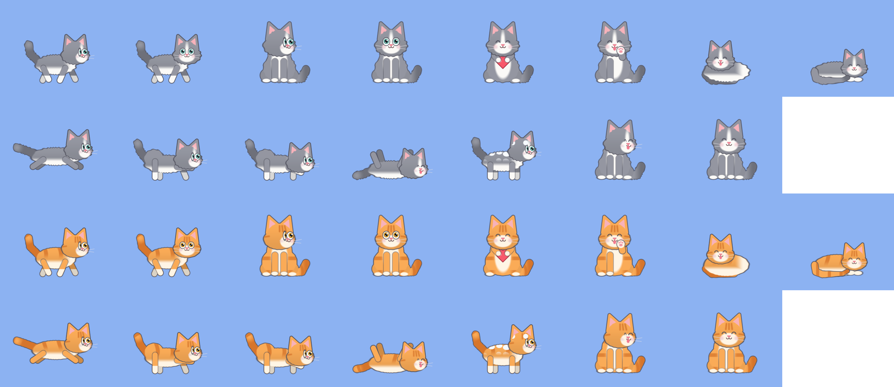

# WinterPurrch

A cozy little world on your Mac desktop. Snow drifts down, piles up on your windows and the Dock, and you can scoop it into snowballs, throw them, or stack them into a snowman.

<p align="center"></p>

WinterPurrch lives in the menu bar. It draws with Metal in a transparent overlay that never gets in the way of your clicks.

## Features

- **Falling snow:** every flake has its own size, depth and sway, and the wind shifts from time to time.
- **Real drifts:** snow settles on the tops of windows, on the Dock's glass and along the bottom of the screen. It slumps to a natural slope and slips off the ends.
- **Windows matter:** snow only shows where a window's top edge is visible. Drag or shake a window and its snow slides off; close or minimize it and the snow drops in clumps.
- **Sweep it:** move the cursor through a drift and the powder sprays aside.
- **Snowballs:** hold **⌥ Option**, press on the snow and drag. The ball grows as it rolls through the snow. Let go while moving to throw it, and it bursts where it lands. Let go gently and it drops and stays put.
- **Snowmen:** stack the balls. With two, the snowman gets a face, buttons and twig arms; with three, a top hat as well.
- **A cat:** an orange tabby lives in the snow. It wanders the drifts leaving paw prints, climbs onto windows, naps, and now and then goes to play in the snow on the Dock, batting it into the air and pouncing on it.
- **Coffee delivery:** every minute or two the cat trots off screen and comes back from either side with a steaming mug, which it leaves somewhere new each time: along the ground, or up on the Dock. Up to five pile up; click one to drink it.
- **Grooming:** they lick a paw and wash their face with it, or turn round to lick their back, especially after shaking off a snowball.
- **Clumsy:** now and then it trips and flops over with its legs in the air and its tongue out, or misjudges the edge of a window and tumbles off. It gets up and shakes the snow off as if nothing happened.
- **Digging:** it paws at deep drifts, throwing the snow back between its legs until it has dug a hole.
- **Startle and pet:** click the cat and it hops up with its fur on end, then dashes off. Hit it with a snowball and it shakes the snow out of its fur. Rest the cursor on it and it sits down and purrs, with hearts; stroke it back and forth for a few seconds and it drifts off to sleep, curled up with its tail round its paws, and stays asleep until you click it awake.
- **A friend:** a chubby ginger tabby with short fur and amber eyes keeps it company. The two go looking for each other, and when they meet they touch noses, wash each other's heads, curl up together for a nap, play-fight, or play tag. Sometimes one just tags along behind the other.
- **Their own business:** they mostly look where they're going and only now and then glance up at you.
- **Adjustable size:** a Cat Size slider in the menu, and a Friend toggle.
- **Blizzard mode:** heavier snow and gusting wind.
- **Light on resources:** about 7% of one core and around 50 MB of memory.

<p align="center"></p>

## Menu

| Item | What it does |
| --- | --- |
| Intensity / Opacity | How much snow falls and how see-through it is |
| Accumulate | Choose where it settles: ground, Dock, windows |
| Blizzard | Heavier snow with gusts |
| Cat / Friend / Cat Size | Show or hide the cat and its friend, and set their size |
| Melt | Drifts slowly thaw so they don't take over the screen |
| Clear Snow | Removes all settled snow and snowballs |
| Pause | Stops the snow |
| Settings | Show in screenshots, open at login |

## Requirements

- macOS 14 or later
- Xcode 16 or later (Swift 6 toolchain) to build

## Building

```sh
./build.sh            # builds build/WinterPurrch.app (ad hoc signed)
./build.sh --install  # copies it to /Applications and launches it
```

### Headless self-test

The simulation can run a scripted scene without a screen and save pictures of it:

```sh
.build/release/WinterPurrch --selftest /tmp/winterpurrch
```

It snows on two windows and a Dock, sweeps a drift with the cursor, builds a snowman, throws a snowball, lets the cat play, jump and fetch coffee, and shakes a window, then prints how deep the snow got and how long a simulation step takes.

### Debug options

```sh
# Every 10 seconds, write each screen's snow state and a picture of it
defaults write com.erdogancayir.WinterPurrch debugDump /tmp/winterpurrch

# Mouse capture log for snowballs
tail -f ~/Library/Logs/WinterPurrch.log
```

## How it works

| File | Role |
| --- | --- |
| `Simulation.swift` | Snow physics: flakes, heightmap drifts, snowballs, snowmen |
| `Cat.swift` | The cat's behaviour, the mugs it brings and the hearts it purrs |
| `Renderer.swift` | Metal shaders for flakes, drifts, snowballs and the cat, drawn from shapes (compiled at runtime) |
| `Overlay.swift` | One transparent panel per screen; takes the mouse only while you make a snowball |
| `Surfaces.swift` | Reads window positions and the Dock's exact frame |
| `AppDelegate.swift` | Menu bar, settings, window tracking |
| `SelfTest.swift` | The headless scene used for testing |

Each surface that collects snow (the ground, the Dock, every window top) is a heightmap of 2-point columns. Landing flakes add to a column, and a relaxation pass keeps slopes under the angle of repose and lets snow spill off open ends as falling clumps.

## Roadmap

- More seasons: autumn leaves, rain, cherry blossom
- Snowmen that survive a restart
