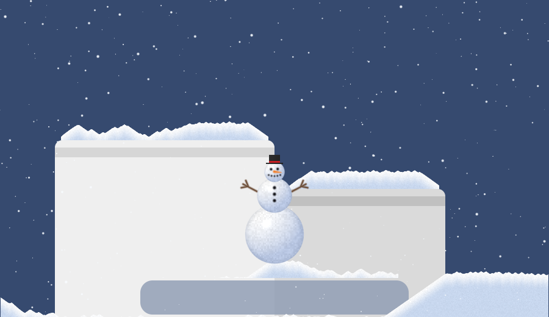

# WinterPurrch

A cozy little world on your Mac desktop. Snow drifts down, piles up on your windows and the Dock, and you can scoop it into snowballs, throw them, or stack them into a snowman.

<p align="center"></p>

WinterPurrch lives in the menu bar. It draws with Metal in a transparent overlay that never gets in the way of your clicks.

## Features

- **Falling snow:** every flake has its own size, depth and sway, and the wind shifts from time to time.
- **Real drifts:** snow settles on the tops of windows, on the Dock's glass and along the bottom of the screen. It slumps to a natural slope and slips off the ends.
- **Windows matter:** snow only shows where a window's top edge is visible. Drag or shake a window and its snow slides off; close or minimize it and the snow drops in clumps.
- **Sweep it:** move the cursor through a drift and the powder sprays aside.
- **Snowballs:** hold **⌥ Option**, press on the snow and drag. The ball grows as it rolls through the snow. Let go while moving to throw it, and it bursts where it lands. Let go gently and it drops and stays put.
- **Snowmen:** stack the balls. With two, the snowman gets a face, buttons and twig arms; with three, a top hat as well.
- **Blizzard mode:** heavier snow and gusting wind.
- **Light on resources:** about 7% of one core and around 50 MB of memory.

## Menu

| Item | What it does |
| --- | --- |
| Intensity / Opacity | How much snow falls and how see-through it is |
| Accumulate | Choose where it settles: ground, Dock, windows |
| Blizzard | Heavier snow with gusts |
| Melt | Drifts slowly thaw so they don't take over the screen |
| Clear Snow | Removes all settled snow and snowballs |
| Pause | Stops the snow |
| Settings | Show in screenshots, open at login |

## Requirements

- macOS 14 or later
- Xcode 16 or later (Swift 6 toolchain) to build

## Building

```sh
./build.sh            # builds build/WinterPurrch.app (ad hoc signed)
./build.sh --install  # copies it to /Applications and launches it
```

### Headless self-test

The simulation can run a scripted scene without a screen and save pictures of it:

```sh
.build/release/WinterPurrch --selftest /tmp/winterpurrch
```

It snows on two windows and a Dock, sweeps a drift with the cursor, builds a snowman, throws a snowball and shakes a window, then prints how deep the snow got and how long a simulation step takes.

### Debug options

```sh
# Every 10 seconds, write each screen's snow state and a picture of it
defaults write com.erdogancayir.WinterPurrch debugDump /tmp/winterpurrch

# Mouse capture log for snowballs
tail -f ~/Library/Logs/WinterPurrch.log
```

## How it works

| File | Role |
| --- | --- |
| `Simulation.swift` | Snow physics: flakes, heightmap drifts, snowballs, snowmen |
| `Renderer.swift` | Metal shaders for flakes, drifts and snowballs (compiled at runtime) |
| `Overlay.swift` | One transparent panel per screen; takes the mouse only while you make a snowball |
| `Surfaces.swift` | Reads window positions and the Dock's exact frame |
| `AppDelegate.swift` | Menu bar, settings, window tracking |
| `SelfTest.swift` | The headless scene used for testing |

Each surface that collects snow (the ground, the Dock, every window top) is a heightmap of 2-point columns. Landing flakes add to a column, and a relaxation pass keeps slopes under the angle of repose and lets snow spill off open ends as falling clumps.

## Roadmap

- A cat that wanders through the drifts, leaves paw prints and brings you coffee
- More seasons: autumn leaves, rain, cherry blossom
- Snowmen that survive a restart
